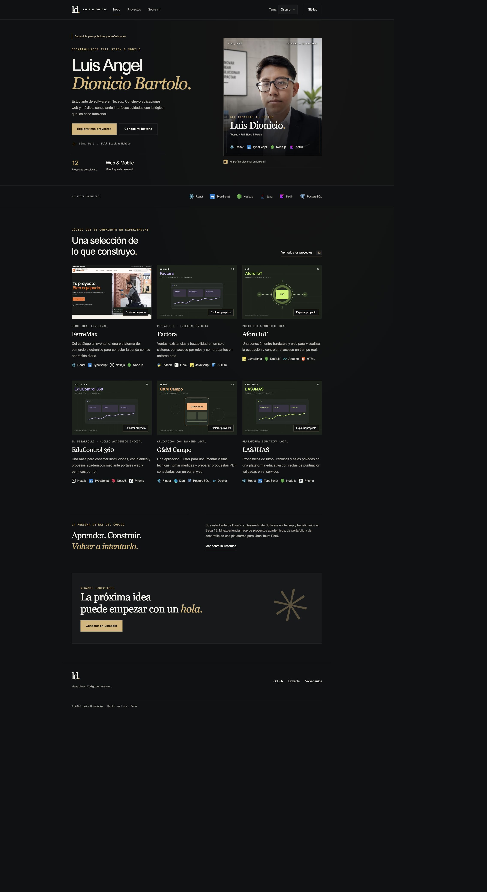
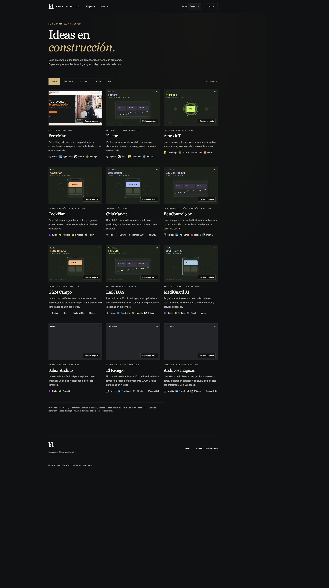
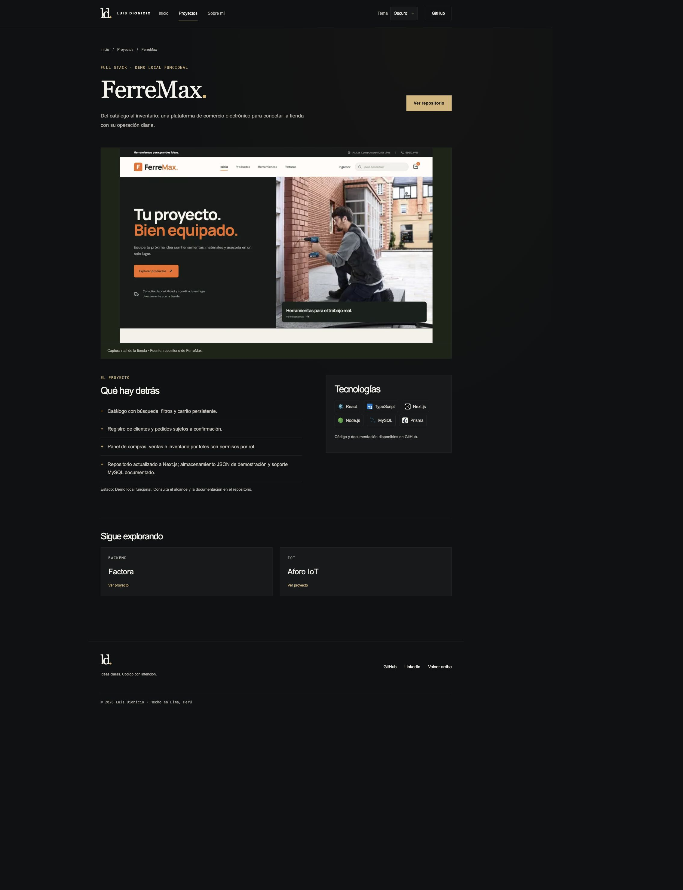
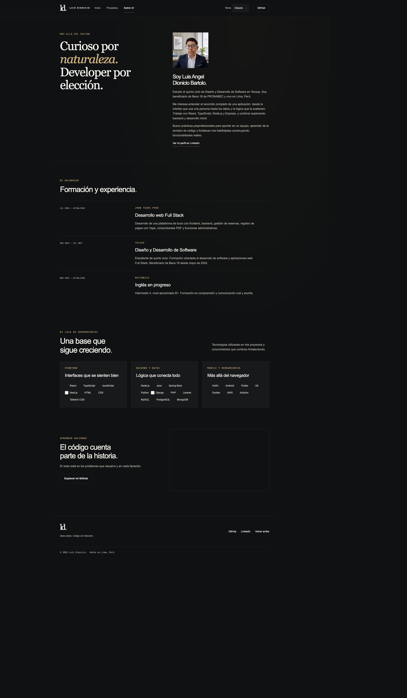
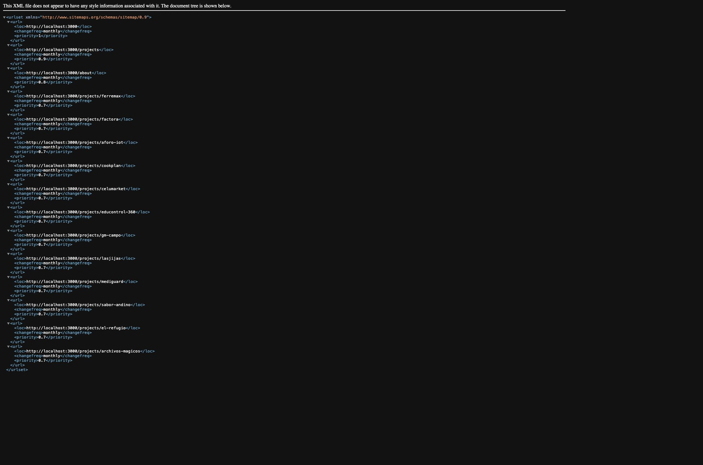
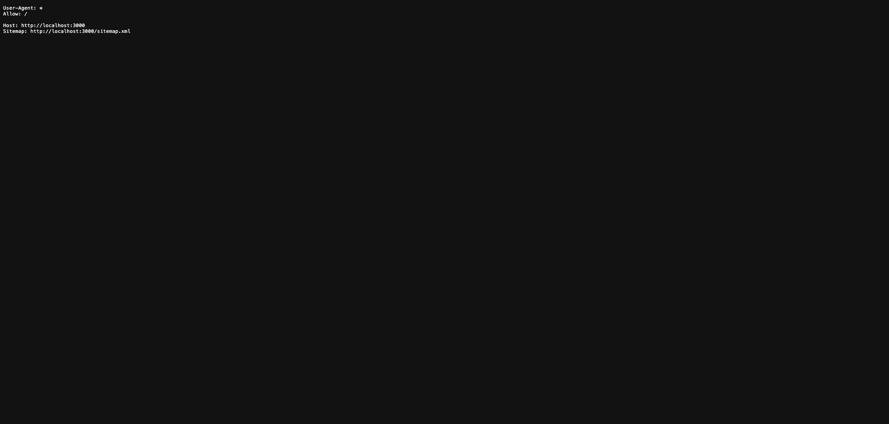

# Laboratorio 14 Optimización y SEO

Luis Angel Dionicio Bartolo · Diseño y Desarrollo de Software · Tecsup

Se desarrolló un portafolio personal con Next.js, información profesional verificada en LinkedIn, fotografía original de perfil, iconos locales y temas adaptativos, con estética editorial en grafito y dorado. [Dirección visual y referencias](DISENO.md). El portafolio incluye doce proyectos de GitHub y seis destacados en la portada. [Fuentes y alcance](PROYECTOS.md). El trabajo cubre las partes 1 a 6 del procedimiento. La sección TAREA se excluyó por indicación del estudiante; no hay página de contacto, dominio personalizado ni despliegue.

## Parte 1 Meta tags dinámicos

El modelo `Project` se encuentra en `src/types/index.ts` y los datos en `src/lib/data.ts`. La configuración común de SEO se centraliza en `src/lib/seo.ts`. `src/app/layout.tsx` define el origen de los metadatos, autor, idioma y configuración general.

Las páginas de inicio, proyectos y perfil tienen títulos y descripciones propios, URL canónica, Open Graph y Twitter Card. El detalle `src/app/projects/[slug]/page.tsx` usa `generateMetadata` con los parámetros asincrónicos de Next.js 16 para obtener el proyecto correspondiente. `generateStaticParams` permite generar sus páginas durante la compilación. Un slug inexistente produce una respuesta 404.

Se usan proyectos reales en lugar de los ejemplos ficticios de la guía. Por ello, la ruta de demostración `/projects/ecommerce-platform` se reemplaza por `/projects/ferremax`.

La inspección de etiquetas del documento se registra en [head-inicio.json](evidencias/head-inicio.json), y la comprobación de las quince rutas en [seo-check.json](evidencias/seo-check.json). La página principal tiene JSON-LD de persona y los detalles de proyecto tienen `SoftwareSourceCode`. Se genera una imagen social de 1200 × 630 con `next/og`.

## Parte 2 Componentes compartidos

`Header`, `Footer`, `ProjectCard` y `TechIcon` se reutilizan en las páginas. El encabezado identifica la ruta activa y ofrece un selector de tema. `ProjectExplorer` filtra los proyectos por Full Stack, Backend, Mobile e IoT; el contador anuncia los resultados.

El diseño del perfil presenta el nombre, la especialidad, la foto de LinkedIn, formación y enlaces reales. La preferencia de color puede ser clara, oscura o automática según el sistema. La elección se conserva entre visitas. Las imágenes e iconos se sirven desde el proyecto y no dependen de enlaces temporales de LinkedIn.

## Parte 3 Imágenes y carga diferida

`next.config.ts` habilita AVIF y WebP y define tamaños para distintos dispositivos. Los dominios externos admitidos están limitados mediante `remotePatterns`. Las imágenes usadas en el portafolio son locales y se entregan con `next/image`.

Las tarjetas y la ilustración de la página de perfil usan `loading="lazy"`. Las imágenes principales de cada página usan precarga. Los atributos `width`, `height` y `sizes` reservan espacio y permiten elegir recursos según la pantalla. La foto de perfil tiene una versión WebP local. La prueba HTTP confirma la respuesta optimizada en AVIF o WebP.

FerreMax utiliza una captura real recortada de su repositorio para mejorar la lectura en tarjetas. Las otras portadas son ilustraciones conceptuales identificadas en el texto alternativo y en los detalles. No se presentan como capturas reales.

### Evidencias de las páginas

[Inicio claro](evidencias/inicio-claro.jpg) · [Inicio oscuro](evidencias/inicio-oscuro.jpg) · [Vista móvil](evidencias/perfil-movil.jpg)

## Parte 4 Sitemap dinámico

`src/app/sitemap.ts` crea `/sitemap.xml` desde las páginas principales y el arreglo de proyectos. Contiene quince URLs: inicio, listado, perfil y los doce detalles. Añadir un proyecto al arreglo incorpora su URL al sitemap en la siguiente compilación.

El origen se obtiene de `NEXT_PUBLIC_SITE_URL`; se utiliza `http://localhost:3000` durante el laboratorio. No se declara un dominio ficticio ni se afirma que estas URLs locales estén indexadas por buscadores.

[XML verificado](evidencias/sitemap.xml)

## Parte 5 Robots

`src/app/robots.ts` permite rastrear el contenido público y referencia el sitemap con el mismo origen. No hay zonas privadas ni rutas de administración que requieran exclusiones en este portafolio.

[Archivo de texto verificado](evidencias/robots.txt)

## Parte 6 Verificación de SEO

Se verificaron títulos únicos, descripciones, canonical, etiquetas Open Graph, Twitter Card, idioma español y un solo encabezado principal por página. También se comprobaron las respuestas de sitemap, robots, imagen social, optimización de imágenes y los errores 404. La página de contacto no existe, conforme al alcance solicitado.

Las auditorías Lighthouse se ejecutaron en Chrome headless, con el servidor de producción `npm start`, en modo Desktop y Mobile para inicio, listado, detalle FerreMax y perfil. Los archivos HTML conservan el detalle de cada auditoría y los JSON permiten reproducir el resumen. Los valores varían con el equipo, caché y carga del sistema; no equivalen a métricas de usuarios en producción.

| Página | Modo | Rendimiento | Accesibilidad | Buenas prácticas | SEO |
| --- | --- | ---: | ---: | ---: | ---: |
| inicio | desktop | 100 | 100 | 100 | 100 |
| inicio | mobile | 100 | 100 | 100 | 100 |
| proyectos | desktop | 100 | 100 | 100 | 100 |
| proyectos | mobile | 94 | 100 | 100 | 100 |
| detalle | desktop | 100 | 100 | 100 | 100 |
| detalle | mobile | 96 | 100 | 100 | 100 |
| perfil | desktop | 100 | 100 | 100 | 100 |
| perfil | mobile | 100 | 100 | 100 | 100 |

Todas las puntuaciones superan 90. [Resumen JSON](evidencias/lighthouse-summary.json).

[inicio desktop](evidencias/lighthouse-inicio-desktop.report.html) · [inicio mobile](evidencias/lighthouse-inicio-mobile.report.html) · [proyectos desktop](evidencias/lighthouse-proyectos-desktop.report.html) · [proyectos mobile](evidencias/lighthouse-proyectos-mobile.report.html) · [detalle desktop](evidencias/lighthouse-detalle-desktop.report.html) · [detalle mobile](evidencias/lighthouse-detalle-mobile.report.html) · [perfil desktop](evidencias/lighthouse-perfil-desktop.report.html) · [perfil mobile](evidencias/lighthouse-perfil-mobile.report.html)

## Pruebas funcionales y visuales

Se comprobó en Chrome que el filtro Mobile devuelve CookPlan, G&M Campo, MediGuard AI y Sabor Andino, y que IoT devuelve Aforo IoT. Se verificó la navegación desde el catálogo hacia el detalle y los enlaces internos entre proyectos. Los temas claro y oscuro cambian la paleta, la preferencia se conserva al navegar y la opción Sistema restaura la adaptación automática. Se revisó el diseño móvil y la carga de la fotografía e imágenes.

`npm run lint`, `npm run build`, `npm run typecheck` y `npm run check:seo` completaron correctamente. La compilación genera estáticamente las páginas principales y los doce detalles.

## Cinco conclusiones

1. Centralizar los datos y los metadatos evita que el título, la descripción y la URL de un proyecto se contradigan entre páginas. Los parámetros de ruta permiten generar información SEO específica sin duplicar cada detalle manualmente.
2. El diseño visual y la optimización pueden convivir. Las imágenes con dimensiones definidas, formatos modernos y carga diferida permiten mantener un perfil con fotografía y proyectos sin descargar todos los recursos como contenido prioritario.
3. El sitemap y robots cumplen funciones distintas: el primero enumera URLs relevantes y el segundo comunica directivas de rastreo. Usar el mismo origen configurado mantiene coherencia entre ambos archivos y las etiquetas canonical.
4. Las auditorías deben realizarse sobre una compilación de producción y complementarse con pruebas reales de navegación. Un puntaje alto no detecta por sí solo todos los problemas de contenido, filtros, adaptación de colores o presentación de las imágenes.
5. Un portafolio resulta más creíble cuando distingue proyectos académicos, prototipos e integraciones beta. Presentar información profesional verificable y documentar los límites de cada trabajo permite mostrar capacidades sin exagerar su estado de producción.

## Repositorio y referencias

[Repositorio del laboratorio](https://github.com/luisdionicio-lgtm/My_Portfolio)

[Perfil profesional de LinkedIn](https://www.linkedin.com/in/luis-angel-dionicio-bartolo-988b26445/) · [Metadata API](https://nextjs.org/docs/app/api-reference/functions/generate-metadata) · [next/image](https://nextjs.org/docs/app/api-reference/components/image) · [Sitemap](https://nextjs.org/docs/app/api-reference/file-conventions/metadata/sitemap) · [Robots](https://nextjs.org/docs/app/api-reference/file-conventions/metadata/robots)
